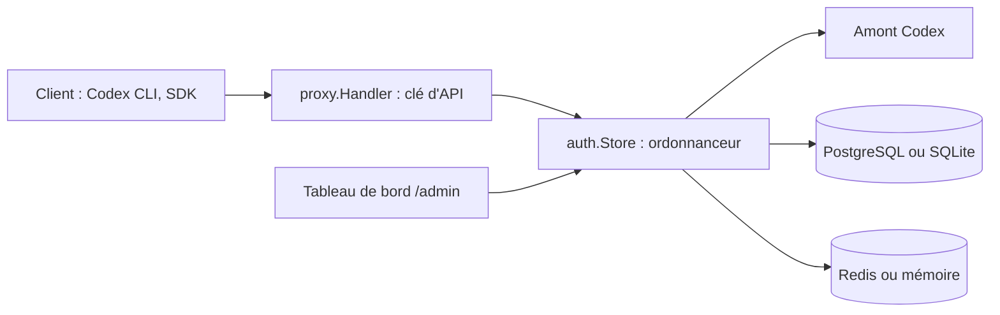

# james-6-23/codex2api

> Self-hosted gateway that exposes a pool of Codex accounts as an OpenAI- and Anthropic-compatible API.

## The problem
Codex accounts have window quotas and limits; clients (Claude Code, OpenAI SDK) expect a single API.

## What it actually does
A Go (Gin) service that serves `/v1/chat/completions`, `/v1/responses`, `/v1/messages`, Grok Imagine images and videos, and models. It manages accounts (refresh or access tokens), a scheduler with a health score and dynamic concurrency, API keys, proxies, a prompt filter, cost tracking per 5 h/7 d window, and a built-in React dashboard. PostgreSQL + Redis, or SQLite + memory.

## How it is wired


## Trying it
```bash
git clone https://github.com/james-6-23/codex2api.git
cd codex2api
cp .env.example .env
docker compose pull
docker compose up -d
```

## Cost and gotchas
Free, but call billing depends on the accounts you put in the pool. With no key configured, `/v1/*` requires no authentication: set one before exposing the service. The Antigravity channel is experimental and stores credentials in clear text.

## What it is not
Not a model service: it redirects to third-party accounts, which may violate their terms (to be checked). No license declared on the repository.

## Alternatives
No alternative named in the README.

## For you
Ignore: pooling consumer accounts is fragile and questionable with respect to terms of use, and the absence of a license prevents building anything on it.
