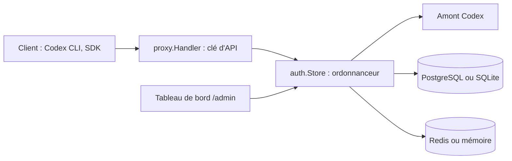

# james-6-23/codex2api

> Passerelle auto-hébergée qui expose un pool de comptes Codex comme API compatible OpenAI et Anthropic.

## Le problème
Les comptes Codex ont des quotas de fenêtre et des limites ; les clients (Claude Code, SDK OpenAI) attendent une API unique.

## Ce que ça fait vraiment
Service Go (Gin) qui sert `/v1/chat/completions`, `/v1/responses`, `/v1/messages`, images et vidéos Grok Imagine, modèles. Il gère des comptes (jetons d'actualisation ou d'accès), un ordonnanceur à score de santé et concurrence dynamique, des clés d'API, des proxys, un filtre de prompts, le suivi de coût par fenêtre 5 h/7 j, et un tableau de bord React intégré. PostgreSQL + Redis, ou SQLite + mémoire.

## Comment c'est branché


## Essayer
```bash
git clone https://github.com/james-6-23/codex2api.git
cd codex2api
cp .env.example .env
docker compose pull
docker compose up -d
```

## Coût et pièges
Gratuit, mais la facturation des appels dépend des comptes que tu mets dans le pool. Sans clé configurée, `/v1/*` n'exige aucune authentification : en définir avant d'exposer le service. Le canal Antigravity est expérimental et stocke les identifiants en clair.

## Ce que ce n'est pas
Pas un service de modèles : il redirige vers des comptes tiers, ce qui peut contrevenir à leurs conditions (à vérifier). Aucune licence déclarée sur le dépôt.

## Alternatives
Aucune alternative nommée dans le README.

## Pour toi
À ignorer : la mutualisation de comptes consommateurs est fragile et douteuse côté conditions d'usage, et l'absence de licence interdit d'y bâtir quoi que ce soit.

