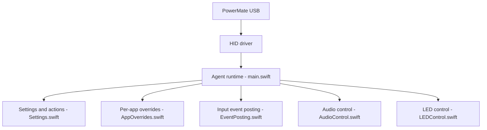

# jameslockman/Griffin-PowerMate-Driver

> macOS driver to make the Griffin PowerMate rotary knob work (scroll, volume, keys), for those who own one.

## The problem
The PowerMate is recognized on the USB bus but does nothing by default on modern macOS.

## What it actually does
A Swift library reads the 6-byte HID reports (button, rotation) and a menu bar agent, PowerMate Agent, translates them into scrolling, system volume, configurable keys, clicks, double-clicks, long presses (including a shell script). Per-application settings exist, and the LED follows audio amplitude via `AudioHardwareCreateProcessTap`.

## How it is wired


## Trying it
```bash
brew tap jameslockman/tap
brew install --cask griffin-powermate-agent
swift build
swift run PowerMateAgent
```

## Cost and gotchas
Free, but you need the PowerMate hardware. macOS 13+, Swift 5.9+. Accessibility, Audio Capture and Input Monitoring permissions must be granted. No license declared in the catalog: legal reuse is unclear.

## What it is not
Not a kernel driver nor a cross-platform tool: macOS only. The README mentions `/path/to/USB` as a folder name, a leftover from development.

## Alternatives
The README cites the PowerMate driver for Linux, without naming it as a repo.

## For you
Ignore: only useful if you have a PowerMate on macOS, unrelated to your data/AI/MLOps work.
