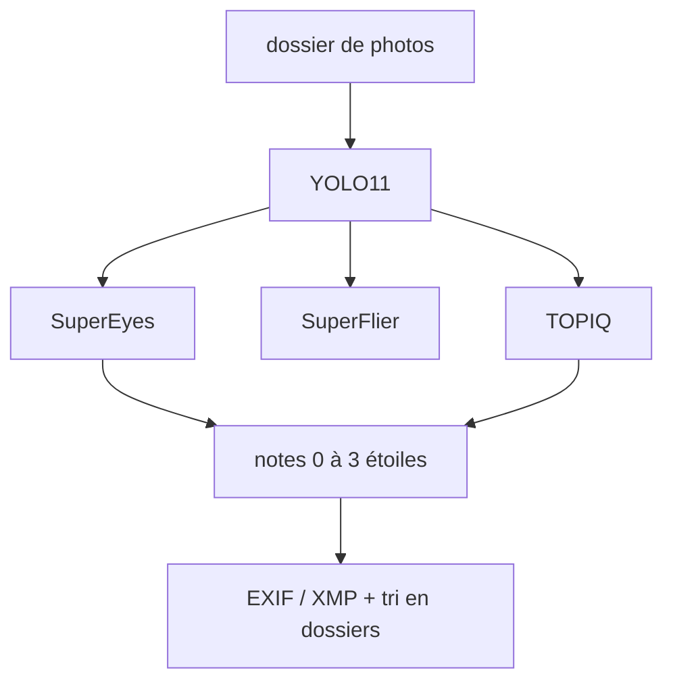

# jamesphotography/SuperPicky

> Software that automatically sorts bird photos using several AI models.

## The problem
Sorting thousands of bird photos to keep the sharp, well-composed ones is time-consuming.

## What it actually does
Combines YOLO11 (detection), SuperEyes (eye visibility, sharpness), SuperFlier (flight) and TOPIQ (aesthetics) to assign 0 to 3 stars, with thresholds per level. Writes the ratings into EXIF/XMP metadata, sorts into folders, Lightroom-compatible. Cache and SQLite database in `.superpicky`.

## How it is wired
Simplified diagram based on the fiche, no diagram provided.


## Trying it
```bash
git clone https://github.com/jamesphotography/SuperPicky.git
cd SuperPicky
pip install -r requirements.txt
python scripts/download_models.py
```

## Cost and gotchas
CUDA version for Windows in beta; model download required for the source code. Download links go through Google Drive and Baidu.

## What it is not
Not a photo editor: it ranks and rates. The thresholds are tuned for sharpness and aesthetics, not artistic value.

## Alternatives
No alternative named.

## For you
Worth watching: a concrete example of assembling vision models, useful as a reference, but limited in scope to bird photos.
