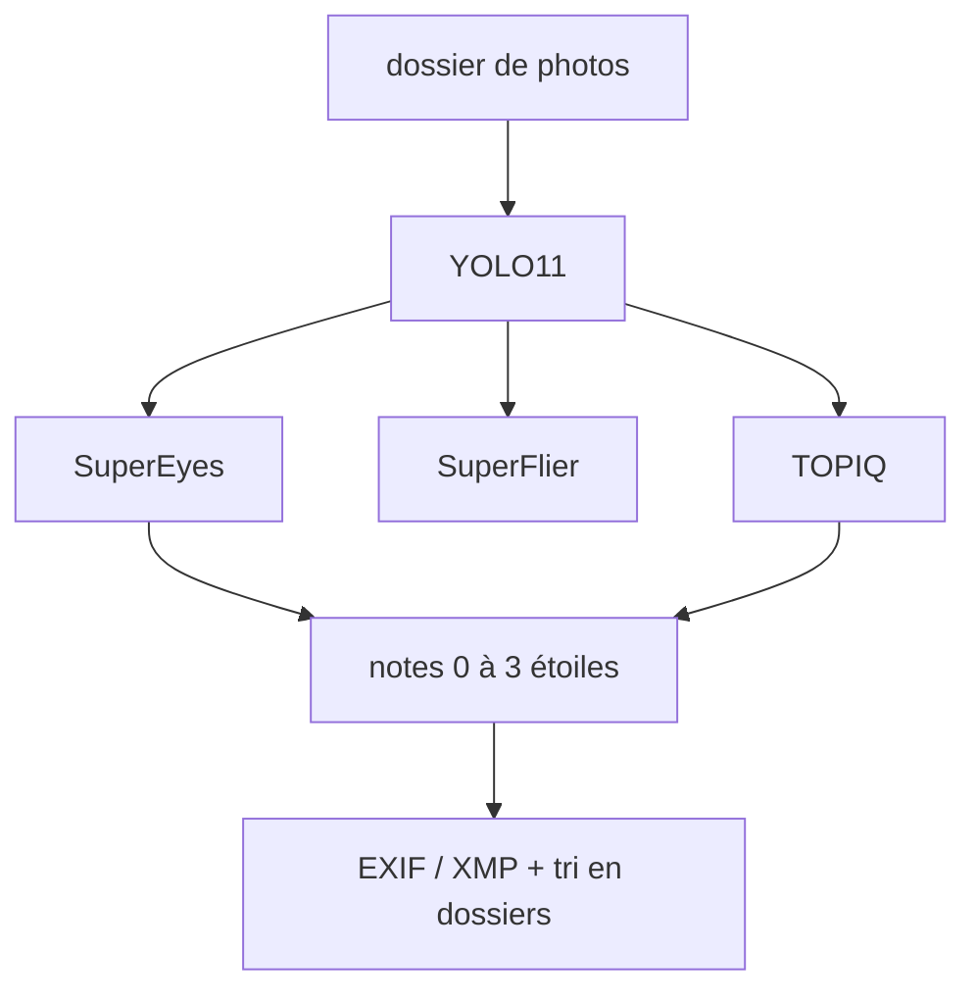

# jamesphotography/SuperPicky

> Logiciel de tri automatique de photos d'oiseaux par plusieurs modèles d'IA.

## Le problème
Trier des milliers de photos d'oiseaux pour retenir les nettes et bien composées est long.

## Ce que ça fait vraiment
Combine YOLO11 (détection), SuperEyes (visibilité de l'œil, netteté), SuperFlier (vol) et TOPIQ (esthétique) pour attribuer 0 à 3 étoiles, avec des seuils par niveau. Écrit les notes dans les métadonnées EXIF/XMP, trie en dossiers, compatible Lightroom. Cache et base SQLite dans `.superpicky`.

## Comment c'est branché
Schéma simplifié d'après la fiche, sans diagramme fourni.


## Essayer
```bash
git clone https://github.com/jamesphotography/SuperPicky.git
cd SuperPicky
pip install -r requirements.txt
python scripts/download_models.py
```

## Coût et pièges
Version CUDA pour Windows en bêta ; téléchargement des modèles requis pour le code source. Les liens de téléchargement passent par Google Drive et Baidu.

## Ce que ce n'est pas
Pas un éditeur photo : il classe et note. Les seuils sont réglés sur la netteté et l'esthétique, pas sur la valeur artistique.

## Alternatives
Aucune alternative nommée.

## Pour toi
À surveiller : exemple concret d'assemblage de modèles de vision, utile comme référence, mais de portée limitée aux photos d'oiseaux.

