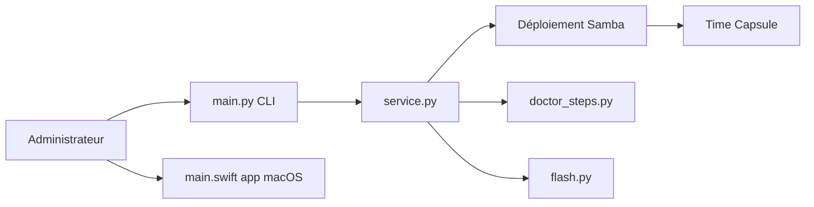

# jamesyc/TimeCapsuleSMB

> Installs Samba 4 directly on an Apple Time Capsule to make it compatible with macOS 27.

## The problem
Time Capsules only speak AFP and SMB1, removed from recent macOS versions, which breaks Time Machine backups.

## What it actually does
Deploys over SSH a static Samba 4.25 binary (a fork modified for NetBSD) onto the device. It advertises SMB via Bonjour, copies the runtime into RAM at boot and serves the HFS+ disks. On NetBSD 4 models, a firmware patch ensures automatic startup. macOS app or `tcapsule` CLI (deploy, doctor, flash, activate).

## How it is wired


## Trying it
```bash
./tcapsule bootstrap
.venv/bin/tcapsule configure
.venv/bin/tcapsule deploy
.venv/bin/tcapsule doctor
```

## Cost and gotchas
Free. Modifying the firmware can render the device unusable; resets during deployment are reported. SMB access is mapped to root. The README says the commands have telemetry enabled by default.

## What it is not
Must not be exposed to the Internet. HFS+ disks only, not FAT32.

## Alternatives
No alternative cited in the README.

## For you
Ignore: useful only if you own a Time Capsule, outside the data/AI scope, with telemetry and firmware modification.
