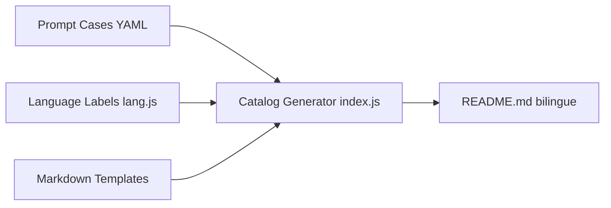

# jamez-bondos/awesome-gpt4o-images

> Collection of 100 prompt cases and images generated with GPT-4o and gpt-image-1, with attributions.

## The problem
Good image prompts are scattered across X/Twitter and Sora, with no record or translation.

## What it actually does
A bilingual README lists 100 numbered cases: prompt, example image, author and sometimes the reference photo to supply. A Node generator (`index.js`, `lang.js`) reads YAML files and Markdown templates to produce the READMEs. The images are under CC BY 4.0.

## How it is wired

## Trying it
No documented command: open the README and copy a prompt into ChatGPT, Sora or the gpt-image-1 API.

## Cost and gotchas
Using ChatGPT/Sora/the API is paid or limited; some prompts need reference images and may trigger moderation.

## What it is not
Not a generation tool. Last push in May 2025: the content is no longer maintained.

## Alternatives
No alternative named in the README.

## For you
Ignore: a creative inspiration gallery, hardly transferable to data/MLOps and frozen for over a year.
