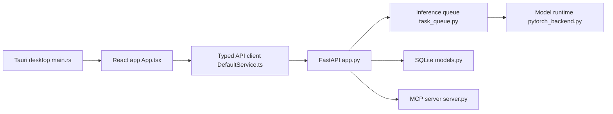

# jamiepine/voicebox

> Local recording studio: voice cloning, synthesis, dictation, and voice-over services for MCP agents, for personal use.

## The problem
The voice tools (ElevenLabs for output, WisprFlow for input) are cloud-based; your voice samples leave your machine.

## What it actually does
Desktop application using the Tauri framework with a local FastAPI server. Eight TTS engines (Qwen3-TTS, Chatterbox, Kokoro, TADA…) can be switched between at each generation, along with audio effects (Pedalboard), a multi-track story editor, dictation via a global shortcut with Whisper, and a local Qwen3 LLM for rewriting text according to a specific persona. An integrated MCP server exposes `voicebox_speak`, `voicebox_transcribe`, and two reading tools.

## How it is wired


## Trying it
```bash
git clone https://github.com/jamiepine/voicebox.git
cd voicebox
just setup
just dev
docker compose up
claude mcp add voicebox --transport http --url http://127.0.0.1:17493/mcp --header "X-Voicebox-Client-Id: claude-code"
```

## Cost and gotchas
Free, but the models are large: a GPU (MLX, CUDA, ROCm, Intel Arc) is recommended, and several GB of downloads are required. There is no pre-compiled Linux binary: compilation from source code (Bun, Rust, Python 3.12). The README states that the project is maintained using the commercial tool Capy.

## What it is not
This is not a hosted service or a production API: everything runs on your own machine. Only Chatterbox Turbo interprets the `[laugh]` tags; the other engines read them as plain text. Voice cloning raises questions of consent that the README does not address.

## Alternatives
- ElevenLabs: Cloud-based hosting, high-quality audio, but your voice still comes from you.
- WisprFlow: also supports dictation, and is hosted.

## For you
Things to watch out for: useful for giving your agents a voice or prototyping locally, but requires only one maintainer and heavy GPU usage; test the `/speak` API before relying on it.
