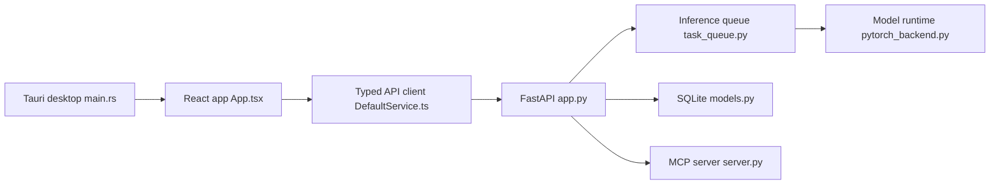

# jamiepine/voicebox

> Studio vocal local : clonage de voix, synthèse, dictée et voix pour agents MCP, pour usage personnel.

## Le problème
Les outils de voix (ElevenLabs en sortie, WisprFlow en entrée) sont dans le cloud ; tes échantillons de voix quittent ta machine.

## Ce que ça fait vraiment
Application de bureau Tauri avec un serveur FastAPI local. Huit moteurs TTS (Qwen3-TTS, Chatterbox, Kokoro, TADA…) commutables à chaque génération, effets audio (Pedalboard), éditeur de histoires multi-pistes, dictée par raccourci global avec Whisper, et un LLM Qwen3 local pour réécrire les textes selon une personnalité. Un serveur MCP intégré expose `voicebox_speak`, `voicebox_transcribe` et deux outils de lecture.

## Comment c'est branché


## Essayer
```bash
git clone https://github.com/jamiepine/voicebox.git
cd voicebox
just setup
just dev
docker compose up
claude mcp add voicebox --transport http --url http://127.0.0.1:17493/mcp --header "X-Voicebox-Client-Id: claude-code"
```

## Coût et pièges
Gratuit, mais les modèles sont lourds : GPU (MLX, CUDA, ROCm, Intel Arc) conseillé, plusieurs Go de téléchargements. Pas de binaire Linux prêt à l'emploi : compilation depuis les sources (Bun, Rust, Python 3.12). Le README dit que le projet est maintenu avec l'outil commercial Capy.

## Ce que ce n'est pas
Pas un service hébergé et pas une API de production : tout tourne sur ta machine. Seul Chatterbox Turbo interprète les balises `[laugh]` ; les autres moteurs les lisent comme du texte. Le clonage de voix soulève des questions de consentement que le README n'aborde pas.

## Alternatives
- ElevenLabs : hébergé, qualité cloud, mais ta voix quitte la machine.
- WisprFlow : dictée seule, également hébergée.

## Pour toi
À surveiller : utile pour donner une voix à tes agents ou prototyper en local, mais un seul mainteneur et un usage GPU lourd ; teste l'API `/speak` avant d'en dépendre.

