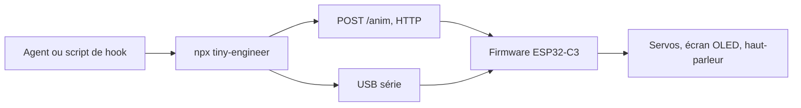

# jamro/tiny-engineer

> Small desk robot that moves and chimes while your coding agent works, for tinkerers.

## The problem
A coding agent works in silence: you can't see whether it is reading, writing, thinking or done.

## What it actually does
A 3D-printed robot, driven by an ESP32-C3, receives poses over HTTP via Wi-Fi or over USB serial. It looks around when the agent reads files, types when it writes, looks up when it thinks and chimes when it finishes. The npm package configures Claude Code, Cursor and Antigravity.

## How it is wired


## Trying it
```bash
npx -y tiny-engineer setup
```
Building the robot follows the repository's "Getting started" guide.

## Cost and gotchas
Hardware to buy: main board, ESP32, five SG90 servos, OLED display, speaker, 3D printer or ordered prints, 5 V power supply at 2 A minimum. Stated difficulty: medium.

## What it is not
Not a pure software tool: without the hardware, it is useless. It is not a data productivity project.

## Alternatives
No alternative named in the README.

## For you
Ignore for your data, AI or MLOps work: it is a hardware gadget, fun but of no value for a pipeline.
