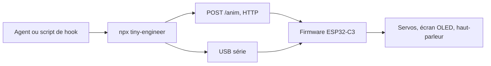

# jamro/tiny-engineer

> Petit robot de bureau qui bouge et sonne quand ton agent de code travaille, pour bricoleurs.

## Le problème
Un agent de code travaille en silence : on ne voit pas s'il lit, écrit, réfléchit ou a fini.

## Ce que ça fait vraiment
Un robot imprimé en 3D, piloté par un ESP32-C3, reçoit des poses par HTTP en Wi-Fi ou par USB série. Il regarde autour de lui quand l'agent lit des fichiers, tape quand il écrit, lève les yeux quand il réfléchit et sonne quand il termine. Le paquet npm configure Claude Code, Cursor et Antigravity.

## Comment c'est branché


## Essayer
```bash
npx -y tiny-engineer setup
```
La construction du robot suit le guide « Getting started » du dépôt.

## Coût et pièges
Matériel à acheter : carte principale, ESP32, cinq servos SG90, écran OLED, haut-parleur, imprimante 3D ou impressions commandées, alimentation 5 V à 2 A minimum. Difficulté annoncée : moyenne.

## Ce que ce n'est pas
Pas un outil logiciel pur : sans le matériel, il ne sert à rien. Ce n'est pas un projet de productivité data.

## Alternatives
Aucune alternative nommée dans le README.

## Pour toi
À ignorer pour ton travail data, IA ou MLOps : c'est un gadget matériel, amusant mais sans valeur pour un pipeline.

