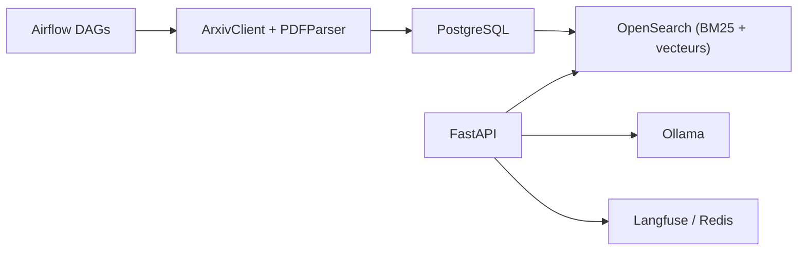

# jamwithai/arxiv-paper-curator

> Seven-week course to build a RAG research assistant over arXiv papers, from keyword search to an agent.

## The problem
RAG tutorials skip the fundamentals; you see neither ingestion, nor keyword search, nor production monitoring.

## What it actually does
A FastAPI project with PostgreSQL, OpenSearch, Airflow and Ollama: fetching arXiv papers, parsing PDFs with Docling, BM25 search, chunking and hybrid search (Jina embeddings, RRF fusion), streamed answers with a local LLM, Langfuse tracing, Redis cache, then a LangGraph agentic flow with document grading, query rewriting and a Telegram bot. Each week has a notebook and a code tag.

## How it is wired


## Trying it
```bash
cp .env.example .env
uv sync
docker compose up --build -d
curl http://localhost:8000/api/v1/health
make start
```

## Cost and gotchas
The course is free; you need at least 8 GB of RAM, 20 GB of disk, a Jina key (week 4+), a Telegram token (week 7), and about 2 to 5 dollars if external LLM APIs are used.

## What it is not
Not a reusable RAG library: it is an end-to-end teaching resource.

## Alternatives
No alternative named in the README.

## For you
Adopt it to learn a complete, observable RAG (hybrid, cache, agent): MIT, a concrete project close to production.
