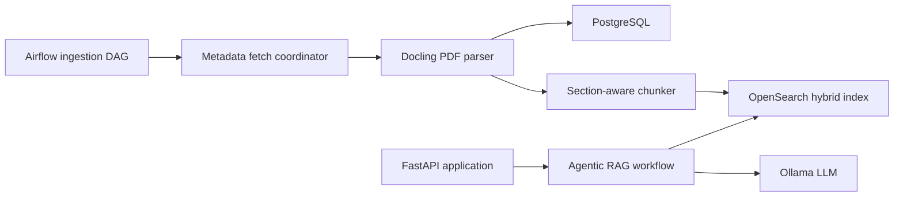

# jamwithai/production-agentic-rag-course

> Seven-week course that builds an agentic RAG assistant over arXiv papers, full Docker stack.

## The problem
RAG tutorials jump straight to vectors and ignore scheduled ingestion, lexical search, observability and caching, all essential in real life.

## What it actually does
Each week adds a layer and a git tag: infrastructure (FastAPI, PostgreSQL, OpenSearch, Airflow, Ollama), arXiv ingestion and Docling PDF parsing, BM25, section-based chunking and RRF hybrid search with Jina embeddings, RAG with streaming and a Gradio interface, Langfuse tracing and Redis cache, then LangGraph agentic RAG (guardrails, document grading, query rewriting) and a Telegram bot.

## How it is wired


## Trying it
```bash
cp .env.example .env
uv sync
docker compose up --build -d
curl http://localhost:8000/api/v1/health
uv run jupyter notebook notebooks/week1/week1_setup.ipynb
make start
```

## Cost and gotchas
8 GB of RAM and 20 GB of disk minimum. A Jina key is required from week 4, Langfuse keys and a Telegram token depending on the week. The clone URL is left as `<repository-url>`.

## What it is not
Not a product to deploy as is: it is a learning path, whose "production-grade" promises are more talk than substance.

## Alternatives
No alternative named in the README.

## For you
Worth adopting as a training path: it assembles exactly the stack an AI engineer encounters (Airflow, hybrid OpenSearch, Langfuse, LangGraph) with one tag per step, ideal for learning or training a team.
