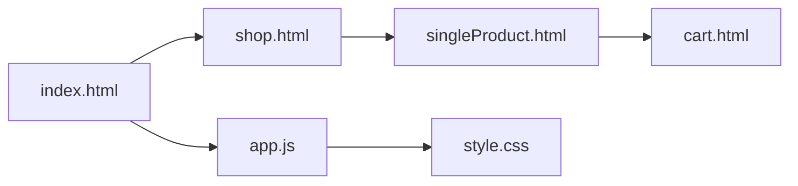

# janavipandole/Cara

> E-commerce site in plain HTML, CSS and JavaScript, plus an API, for learning or contributing to an open project.

## The problem
Show how to build a responsive online shop without a framework, with a cart and product pages.

## What it actually does
Static pages (home, shop, product, cart, blog, contact) and JavaScript modules: currency conversion, coupons, dark mode, client-side XSS sanitizing, accessibility. The README also mentions an API and a Postgres database via Docker Compose. Payment, administration and the link to the backend are listed as not done.

## How it is wired


## Trying it
```bash
git clone https://github.com/janavipandole/Cara.git
cd Cara
cp .env.example .env
docker compose up --build -d
npm install
npm run lint
```

## Cost and gotchas
Free. The `Cara-main/` folder is an archive copy not to be modified. The README contradicts itself on what is delivered (backend and payment unchecked).

## What it is not
It is not a shop ready to sell: no payment gateway and no admin panel. Client-side JavaScript protections are no substitute for server-side security.

## Alternatives
No alternative named in the README.

## For you
Ignore: an educational front-end demo, unrelated to data, AI or MLOps, with unreliable README content.
