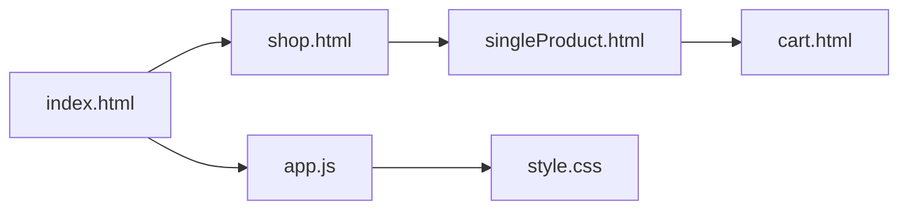

# janavipandole/Cara

> Site e-commerce en HTML, CSS et JavaScript pur, plus une API, pour apprendre ou contribuer à un projet ouvert.

## Le problème
Montrer comment construire une boutique en ligne responsive sans framework, avec panier et pages produit.

## Ce que ça fait vraiment
Des pages statiques (accueil, boutique, produit, panier, blog, contact) et des modules JavaScript : conversion de devises, coupons, mode sombre, nettoyage XSS côté client, accessibilité. Le README mentionne aussi une API et une base Postgres via Docker Compose. Le paiement, l'administration et le lien au backend sont listés comme non faits.

## Comment c'est branché


## Essayer
```bash
git clone https://github.com/janavipandole/Cara.git
cd Cara
cp .env.example .env
docker compose up --build -d
npm install
npm run lint
```

## Coût et pièges
Gratuit. Le dossier `Cara-main/` est une copie d'archive à ne pas modifier. Le README se contredit sur ce qui est livré (backend et paiement non cochés).

## Ce que ce n'est pas
Ce n'est pas une boutique prête à vendre : pas de passerelle de paiement ni de panneau d'administration. Les protections JavaScript côté client ne remplacent pas une sécurité serveur.

## Alternatives
Aucune alternative nommée dans le README.

## Pour toi
À ignorer : démo front pédagogique, sans lien avec la donnée, l'IA ou le MLOps, et au contenu de README peu fiable.

