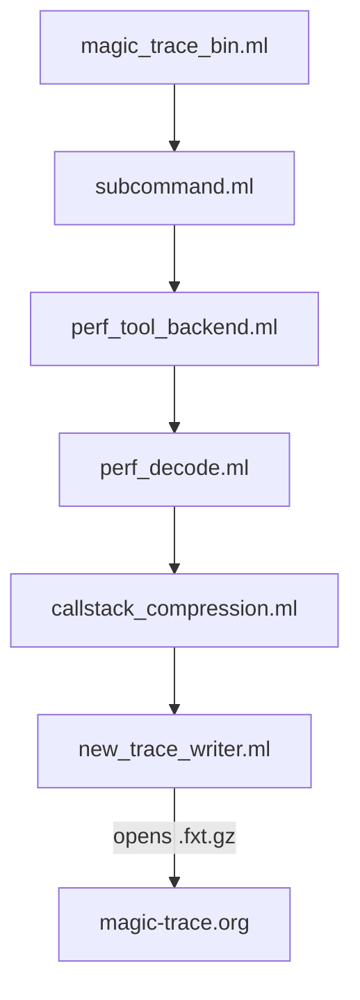

# janestreet/magic-trace

> Jane Street command-line tool that records every function call of a Linux process on Intel.

## The problem
Sampling profilers miss slow requests and what the code actually does right before a crash.

## What it actually does
It relies on `perf` and Intel Processor Trace to keep the whole control flow in a circular buffer. On a trigger (Ctrl+C or a call to a chosen function with `-trigger`), it reconstructs call stacks over about 10 ms, with a resolution of about 40 ns and an overhead of 2% to 10%. It writes a `trace.fxt.gz` file to open in magic-trace.org.

## How it is wired


## Trying it
```bash
gcc demo.c -ldl -o demo
./demo
magic-trace attach -pid $(pidof demo)
```

## Cost and gotchas
Free, MIT license. It requires Linux, an Intel Skylake or newer processor, and virtual machines are generally excluded. Elevated privileges are sometimes needed, notably with `-trace-include-kernel`.

## What it is not
It is not a statistical profiler: it does not replace `perf`, the two complement each other. It does not work on AMD, ARM or macOS.

## Alternatives
The README compares it with `perf`, which samples instead of tracing every call.

## For you
Worth watching: valuable for debugging the latency of an inference service on an Intel server, useless as soon as you are on a VM, AMD or Mac.
