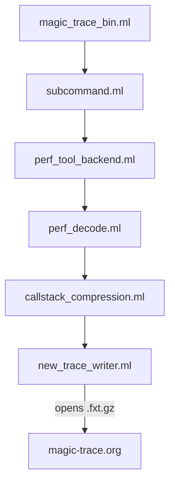

# janestreet/magic-trace

> Outil en ligne de commande de Jane Street qui enregistre chaque appel de fonction d'un processus Linux sur Intel.

## Le problème
Les profileurs par échantillonnage manquent les requêtes lentes et ce que le code fait vraiment juste avant un plantage.

## Ce que ça fait vraiment
Il s'appuie sur `perf` et Intel Processor Trace pour garder dans un tampon circulaire tout le flux de contrôle. À un déclencheur (Ctrl+C ou appel d'une fonction choisie avec `-trigger`), il reconstruit les piles d'appels sur environ 10 ms, avec une résolution d'environ 40 ns et un surcoût de 2 % à 10 %. Il écrit un fichier `trace.fxt.gz` à ouvrir dans magic-trace.org.

## Comment c'est branché


## Essayer
```bash
gcc demo.c -ldl -o demo
./demo
magic-trace attach -pid $(pidof demo)
```

## Coût et pièges
Gratuit, licence MIT. Il exige Linux, un processeur Intel Skylake ou plus récent, et les machines virtuelles sont en général exclues. Des droits élevés sont parfois nécessaires, notamment avec `-trace-include-kernel`.

## Ce que ce n'est pas
Ce n'est pas un profileur statistique : il ne remplace pas `perf`, les deux se complètent. Il ne marche pas sur AMD, ARM ni macOS.

## Alternatives
Le README compare avec `perf`, qui échantillonne au lieu de tracer chaque appel.

## Pour toi
À surveiller : précieux pour déboguer la latence d'un service d'inférence sur serveur Intel, inutile dès que tu es sur VM, AMD ou Mac.

