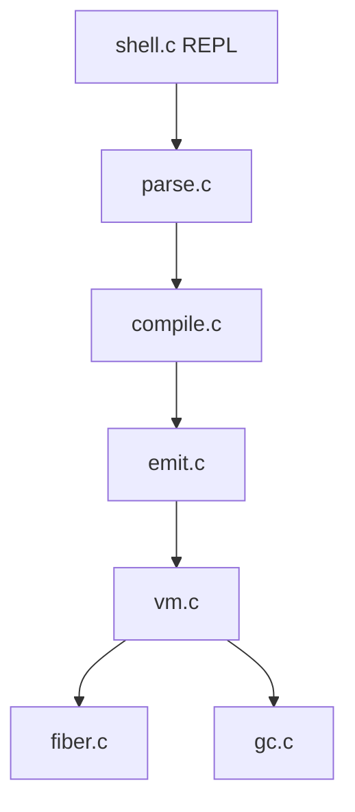

# janet-lang/janet

> Lightweight Lisp-like scripting language, embeddable in C, to automate or extend programs.

## The problem
Extending a C program or scripting the system requires a language richer than Lua but easier to embed than Python or Guile.

## What it actually does
A language with more than 600 functions and macros, an event loop, sockets, threads, a PEG engine, a C FFI and a debugger in the REPL. It is distributed as `janet.c` and `janet.h` to be integrated. The client (REPL, scripts) is separate from the core; speed is that of an interpreter without a JIT.

## How it is wired
Diagram based on the one provided.



## Trying it
```bash
make
make test
make repl
make install
janet myscript.janet
```

## Cost and gotchas
Free. Built with GNU make and a C compiler. The Spork modules, less stable, are separate. The README does not provide a language specification.

## What it is not
Not a Scheme or a Common Lisp (no cons cells), not a Clojure port. Not made for intensive numerical computation.

## Alternatives
- Lua: smaller, fewer built-in functions.
- GNU Guile: richer, harder to embed.
- Python: richer, harder to embed.

## For you
Ignore: a new niche language brings nothing to your data/AI pipelines, where Python remains the tool.
