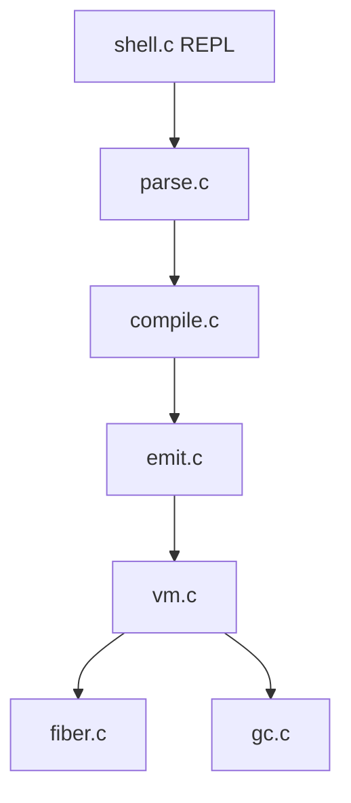

# janet-lang/janet

> Langage de script type Lisp, léger et embarquable en C, pour automatiser ou étendre des programmes.

## Le problème
Étendre un programme C ou scripter le système demande un langage plus riche que Lua mais plus facile à embarquer que Python ou Guile.

## Ce que ça fait vraiment
Un langage avec plus de 600 fonctions et macros, boucle d'événements, sockets, threads, moteur PEG, FFI C et débogueur dans le REPL. Il se distribue en `janet.c` et `janet.h` à intégrer. Le client (REPL, scripts) est séparé du noyau ; la vitesse est celle d'un interpréteur sans JIT.

## Comment c'est branché
Schéma d'après le diagramme fourni.



## Essayer
```bash
make
make test
make repl
make install
janet myscript.janet
```

## Coût et pièges
Gratuit. Compilation avec make GNU et un compilateur C. Les modules Spork, moins stables, sont à part. Le README ne prévoit pas de spécification du langage.

## Ce que ce n'est pas
Pas un Scheme ni un Common Lisp (pas de cellules cons), pas un portage de Clojure. Pas fait pour le calcul numérique intensif.

## Alternatives
- Lua : plus petit, moins de fonctions intégrées.
- GNU Guile : plus riche, plus dur à embarquer.
- Python : plus riche, plus dur à embarquer.

## Pour toi
À ignorer : un nouveau langage de niche n'apporte rien à tes pipelines data/IA, où Python reste l'outil.

