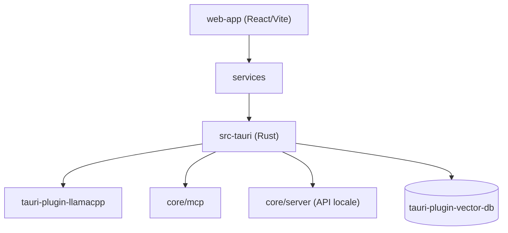

# janhq/jan

> Desktop application for running LLMs locally or through cloud providers.

## The problem
Using open models requires balancing the need for powerful engines, model downloads, and APIs, without a unified interface or ensuring data privacy.

## What it actually does
Download models from HuggingFace (Llama, Gemma, Qwen), run them using llama.cpp, MLX, or Foundation Models, or connect to OpenAI, Anthropic, Mistral, or Groq. Personalized assistants, MCP, RAG on attachments, OpenAI-compatible server on `localhost:1337`. Tauri (Rust) application with React front-end.

## How it is wired


## Trying it
```bash
git clone https://github.com/janhq/jan
cd jan
make dev
```
Alternatively, you can download the installer from jan.ai or GitHub Releases.

## Cost and gotchas
Free; RAM: 8GB for 3B, 16GB for 7B, 32GB for 13B. GPU recommended. You are responsible for obtaining API keys for cloud models. Compilation: Node 20+, Yarn, Make, Rust.

## What it is not
This is not a production inference server. The license is present but not identified by GitHub: please read before reuse.

## Alternatives
No alternative is specified in the README.

## For you
This is intended for testing local models and exposing an OpenAI-compatible API that is under development; please verify the license before using it for any commercial purpose.
