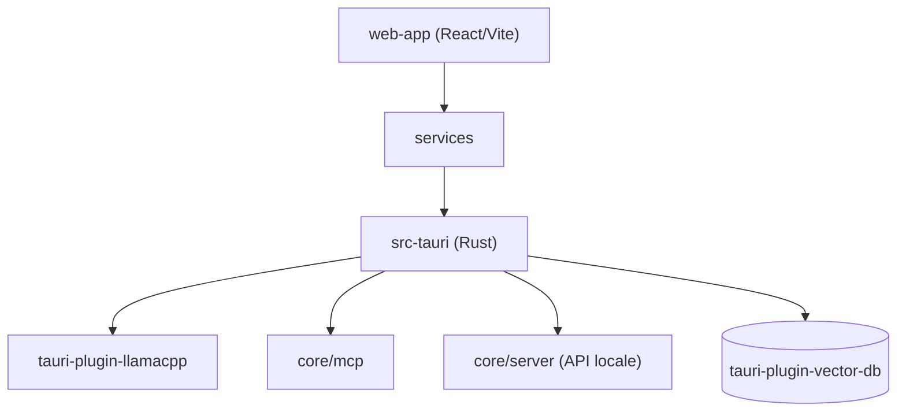

# janhq/jan

> Application de bureau pour faire tourner des LLM en local ou via des fournisseurs cloud.

## Le problème
Utiliser des modèles ouverts demande de jongler entre moteurs, téléchargements de modèles et API sans interface unifiée ni confidentialité.

## Ce que ça fait vraiment
Télécharge des modèles depuis HuggingFace (Llama, Gemma, Qwen), les exécute via llama.cpp, MLX ou Foundation Models, ou se connecte à OpenAI, Anthropic, Mistral, Groq. Assistants personnalisés, MCP, RAG sur pièces jointes, serveur compatible OpenAI sur `localhost:1337`. Application Tauri (Rust) avec front React.

## Comment c'est branché


## Essayer
```bash
git clone https://github.com/janhq/jan
cd jan
make dev
```
Sinon, télécharger l'installeur sur jan.ai ou GitHub Releases.

## Coût et pièges
Gratuit ; RAM : 8 Go pour 3B, 16 Go pour 7B, 32 Go pour 13B. GPU conseillé. Clés d'API à ta charge pour les modèles cloud. Compilation : Node 20+, Yarn, Make, Rust.

## Ce que ce n'est pas
Pas un serveur d'inférence de production. La licence est présente mais non identifiée par GitHub : à lire avant réutilisation.

## Alternatives
Aucune alternative nommée dans le README.

## Pour toi
À adopter pour tester des modèles locaux et exposer une API compatible OpenAI en développement ; vérifier la licence avant tout usage commercial.

