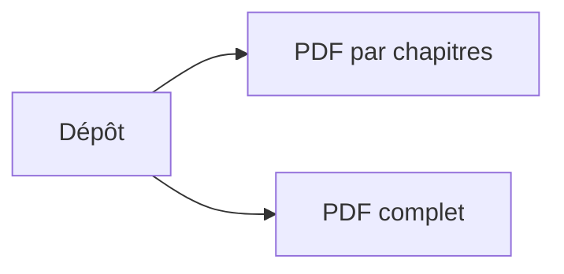

# janishar/mit-deep-learning-book-pdf

> PDF version, complete and by chapter, of the Deep Learning book by Goodfellow, Bengio and Courville.

## The problem
The reference book is only offered as HTML on its website, which makes offline reading awkward.

## What it actually does
The repository contains PDFs made from printouts of the HTML content: the whole book and one PDF per chapter. The README adds links to exercises, slides and external resources, and an ad for a data project template by the author.

## How it is wired
Simplified diagram based on the sheet, no diagram provided.

No diagram: it is a repository of PDF files. Not documented.

## Trying it
No documented command: download the PDFs from the repository.

## Cost and gotchas
Free. The repository author encourages buying the book (72 dollars according to the README).

## What it is not
Not an official source: it is a copy reconstructed by a third party, with no declared license. The book can be read for free at deeplearningbook.org.

## Alternatives
- http://www.deeplearningbook.org/ : official online version, to be preferred.

## For you
Ignore: prefer the book's official website over a PDF copy with no declared license.
