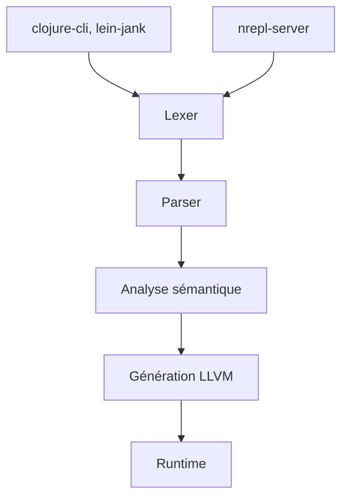

# jank-lang/jank

> Clojure dialect on LLVM with C++ interoperability, for those who want native performance.

## The problem
Clojure runs on the JVM: no native runtime, and the targeted interoperability is Java, not C++.

## What it actually does
A Clojure-compatible language hosted on LLVM, with direct C++ calls (header inclusion, C++ types). Compiler and runtime in `compiler+runtime`, integrations `clojure-cli`, `lein-jank`, `nrepl-server`. The README states it is alpha.

## How it is wired

## Trying it
No command in the README: see the online "jank book". A Clojure code example with `cpp/cast` and Boost is provided.

## Cost and gotchas
Free. You must build with LLVM; being alpha, breaking changes are likely. Third-party dependencies (Boost, CLI11).

## What it is not
Not a production Clojure: neither full compatibility nor stability is guaranteed. Not a simple script, it is a compiler.

## Alternatives
- Clojure on the JVM: the default host, mature.

## For you
Watch: interesting for native computing in Lisp, but alpha and without a data ecosystem, so not for immediate use.
