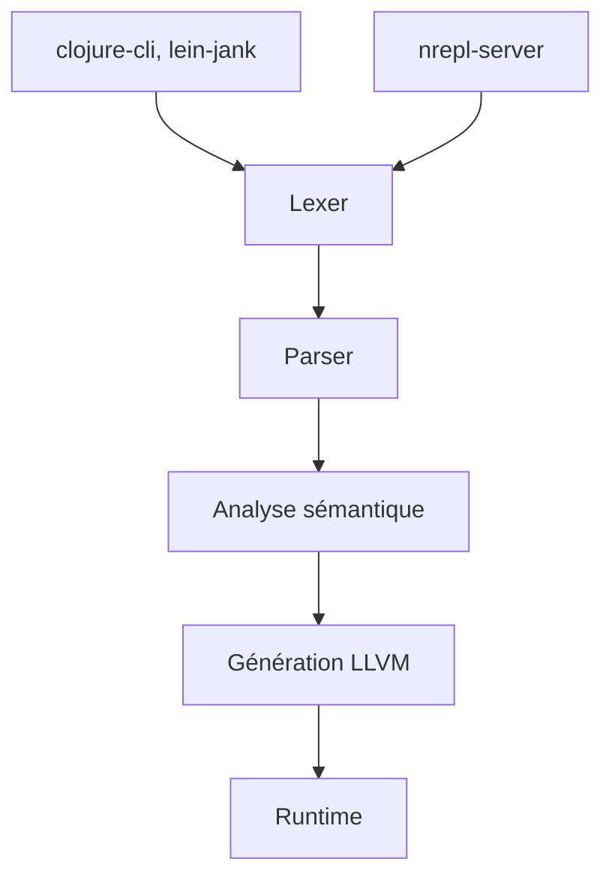

# jank-lang/jank

> Dialecte de Clojure sur LLVM avec interopérabilité C++, pour qui veut la performance native.

## Le problème
Clojure tourne sur la JVM : pas de runtime natif, et l'interopérabilité visée est Java, pas C++.

## Ce que ça fait vraiment
Langage compatible avec Clojure dont l'hôte est LLVM, avec appel direct du C++ (inclusion d'en-têtes, types C++). Compilateur et runtime dans `compiler+runtime`, intégrations `clojure-cli`, `lein-jank`, `nrepl-server`. Le README précise qu'il est en alpha.

## Comment c'est branché

## Essayer
Aucune commande dans le README : voir le « jank book » en ligne. Exemple de code Clojure avec `cpp/cast` et Boost fourni.

## Coût et pièges
Gratuit. Il faut compiler avec LLVM ; en alpha, des changements incompatibles sont probables. Dépendances tierces (Boost, CLI11).

## Ce que ce n'est pas
Pas un Clojure de production : ni la compatibilité totale ni la stabilité ne sont garanties. Pas un simple script, c'est un compilateur.

## Alternatives
- Clojure sur la JVM : l'hôte par défaut, mûr.

## Pour toi
Surveiller : intéressant pour du calcul natif en Lisp, mais alpha et sans écosystème data, donc pas pour un usage immédiat.

