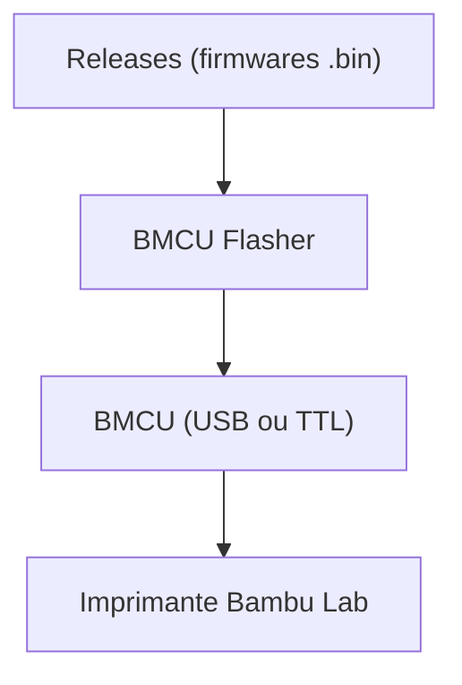

# jarczakpawel/BMCU-C-PJARCZAK

> Firmware for the BMCU, a Bambu Lab AMS-compatible filament changer, and calibration notes.

## The problem
Bambu Lab printer firmware updates limit interoperability with a local BMCU.

## What it actually does
Provides firmwares (AMS_AUTO recommended, AMS_A to AMS_D legacy) with guides. The README describes, per printer model and firmware version, what works (A1, P1, X1) or not (P2S, H2D, X2D, A2L). Explains buffer calibration and the BMCU Flasher flashing tool.

## How it is wired

Simplified diagram based on the sheet, no diagram provided.

## Trying it
```bash
# Aucune commande : télécharger depuis Releases puis flasher avec BMCU Flasher.
```

## Cost and gotchas
BMCU hardware required. Never flash or hot-plug onto a powered-on printer, at the risk of damaging the motherboard. No license; the author disclaims all liability.

## What it is not
Not compatible with the recent firmwares of several printers (P2S, H2D, X2D, A2L). Not guaranteed by the manufacturer.

## Alternatives
No alternative named in the README.

## For you
3D printer electronics unrelated to data / AI, and unlicensed: ignore.
