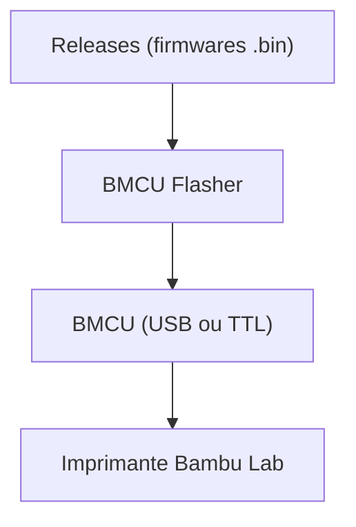

# jarczakpawel/BMCU-C-PJARCZAK

> Firmware pour le BMCU, changeur de filament compatible AMS de Bambu Lab, et notes de calibration.

## Le problème
Les mises à jour de firmware des imprimantes Bambu Lab limitent l'interopérabilité avec un BMCU local.

## Ce que ça fait vraiment
Fournit des firmwares (AMS_AUTO recommandé, AMS_A à AMS_D hérités) avec des guides. Le README décrit, par modèle d'imprimante et version de firmware, ce qui fonctionne (A1, P1, X1) ou non (P2S, H2D, X2D, A2L). Explique la calibration des tampons et l'outil de flashage BMCU Flasher.

## Comment c'est branché

Schéma simplifié d'après la fiche, sans diagramme fourni.

## Essayer
```bash
# Aucune commande : télécharger depuis Releases puis flasher avec BMCU Flasher.
```

## Coût et pièges
Matériel BMCU requis. Ne jamais flasher ni brancher à chaud sur l'imprimante allumée, au risque d'abîmer la carte mère. Sans licence ; l'auteur décline toute responsabilité.

## Ce que ce n'est pas
Pas compatible avec les firmwares récents de plusieurs imprimantes (P2S, H2D, X2D, A2L). Pas garanti par le constructeur.

## Alternatives
Aucune alternative nommée dans le README.

## Pour toi
Électronique d'imprimante 3D sans lien avec la data / IA, et sans licence : à ignorer.

