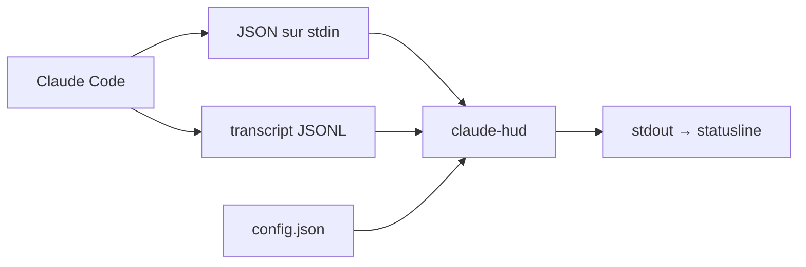

# jarrodwatts/claude-hud

> Status bar for Claude Code: context, tools, sub-agents and todos under the prompt.

## The problem
You discover context saturation only when compaction kicks in, too late.
What the agent is doing — which files, which sub-agents, how far along it is — stays invisible between replies.

## What it actually does
Uses the native statusline API: no separate window, no tmux, works in any terminal.
Line 1: model, detected provider, project path, git branch. Line 2: context bar and quota consumption.
Optional lines: tool activity, running sub-agents with duration, todo progress.
Native token data (not estimated), prompt cache expiry in wall-clock time, cost for the day, more than sixty options.

## How it is wired


## Trying it
```bash
claude plugin marketplace add jarrodwatts/claude-hud
claude plugin install claude-hud@claude-hud
mkdir -p ~/.cache/tmp && TMPDIR=~/.cache/tmp claude
winget install OpenJS.NodeJS.LTS
```

## Cost and gotchas
Free; on Windows, Node.js LTS is the runtime the installer expects.
The displayed cost stays hidden for Bedrock and Vertex unless explicitly enabled, since these providers may report `$0.00`.

## What it is not
Not a reliable billing tracker: native field when it exists, local estimate otherwise, and counted per machine.
The displayed memory is approximate system RAM, not Claude Code's actual memory pressure.
The README provided here is truncated in the middle of the section on usage limits.

## Alternatives
No alternative named in the README.

## For you
Real comfort when you chain long sessions: the context bar avoids compactions you did not choose.
