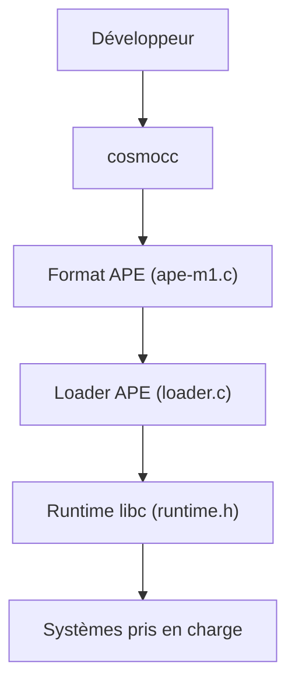

# jart/cosmopolitan

> C/C++ libc that produces single executables running on Linux, Mac, Windows and BSD without an interpreter.

## The problem
Distributing a native binary for each system requires as many builds and packages.

## What it actually does
Reconfigures GCC and Clang (`cosmocc`) to emit a polyglot format (APE) natively executable on several systems. Provides the APE loader, a libc, signal handling and a few programs. Built-in tracing: `--strace` and `--ftrace`.

## How it is wired


## Trying it
```sh
mkdir -p cosmocc && cd cosmocc
wget https://cosmo.zip/pub/cosmocc/cosmocc.zip
unzip cosmocc.zip
cosmocc -o hello hello.c
./hello --strace
```

## Cost and gotchas
On Linux or WSL, `binfmt_misc` may intercept MZ executables: a root setting is sometimes needed. Building the whole repository is heavy.

## What it is not
Not a virtual machine. Not designed for Python or ML; some old shells require a workaround.

## Alternatives
No alternative named in the README (musl is mentioned as a comparison of build mode).

## For you
Watch: a useful curiosity for distributing a small CLI tool everywhere, of little relevance to the core of an ML pipeline.
