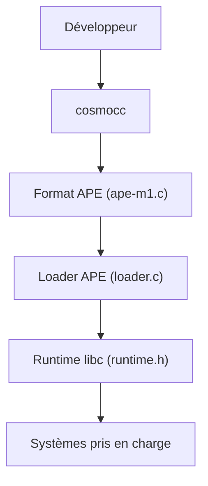

# jart/cosmopolitan

> Libc C/C++ qui produit des exécutables uniques tournant sur Linux, Mac, Windows et BSD sans interpréteur.

## Le problème
Distribuer un binaire natif pour chaque système demande autant de compilations et de paquets.

## Ce que ça fait vraiment
Reconfigure GCC et Clang (`cosmocc`) pour émettre un format polyglotte (APE) exécutable nativement sur plusieurs systèmes. Fournit le loader APE, une libc, du traitement du signal et quelques programmes. Traçage intégré : `--strace` et `--ftrace`.

## Comment c'est branché


## Essayer
```sh
mkdir -p cosmocc && cd cosmocc
wget https://cosmo.zip/pub/cosmocc/cosmocc.zip
unzip cosmocc.zip
cosmocc -o hello hello.c
./hello --strace
```

## Coût et pièges
Sous Linux ou WSL, `binfmt_misc` peut intercepter les exécutables MZ : réglage root parfois nécessaire. Compiler le dépôt entier est lourd.

## Ce que ce n'est pas
Pas une machine virtuelle. Pas pensé pour Python ou ML ; certains shells anciens exigent un contournement.

## Alternatives
Aucune alternative nommée dans le README (musl est cité comme comparaison de mode de compilation).

## Pour toi
Surveiller : curiosité utile pour distribuer un petit outil CLI partout, peu pertinent pour le cœur d'un pipeline ML.

