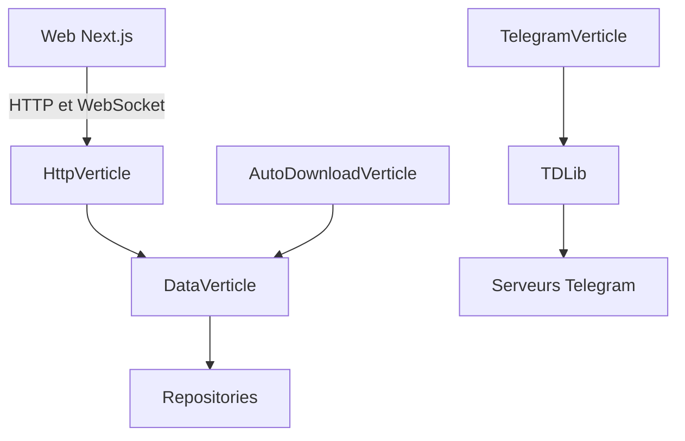

# jarvis2f/telegram-files

> Self-hosted Telegram file downloader, continuous and unattended, with a web interface.

## The problem
Manually retrieving files from Telegram channels and groups is slow and easily interrupted.

## What it actually does
Downloads files from channels and groups, with multiple accounts, pause and resume, automatic moving to destinations, video and image preview, shared links. Mobile-friendly web interface (PWA). Java Vert.x backend with TDLib, Next.js interface, WebSocket for real time.

## How it is wired


## Trying it
```bash
curl -fsSL https://raw.githubusercontent.com/jarvis2f/telegram-files/main/scripts/deploy.sh | bash
./scripts/deploy.sh start
docker-compose up -d
```

## Cost and gotchas
Free. You need a Telegram `api_id` and `api_hash`. On first start, a one-time 15-minute code creates the administrator: do this before any exposure. HTTPS recommended.

## What it is not
Not a full Telegram client. Depends on Telegram. Not tied to a data / AI use.

## Alternatives
No alternative named in the README.

## For you
Ignore: a download utility unrelated to data / AI / MLOps work.
