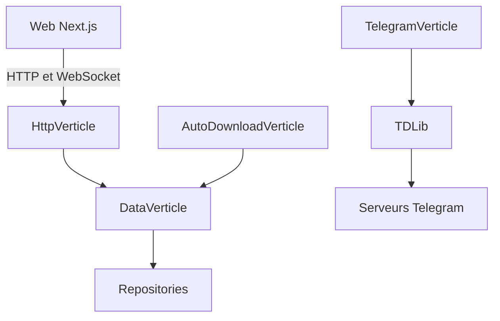

# jarvis2f/telegram-files

> Téléchargeur auto-hébergé de fichiers Telegram, continu et sans surveillance, avec interface web.

## Le problème
Récupérer à la main les fichiers de canaux et groupes Telegram est long et s'interrompt facilement.

## Ce que ça fait vraiment
Télécharge les fichiers de canaux et groupes, avec plusieurs comptes, pause et reprise, déplacement automatique vers des destinations, aperçu de vidéos et d'images, liens partagés. Interface web adaptée au mobile (PWA). Backend Java Vert.x avec TDLib, interface Next.js, WebSocket pour le temps réel.

## Comment c'est branché


## Essayer
```bash
curl -fsSL https://raw.githubusercontent.com/jarvis2f/telegram-files/main/scripts/deploy.sh | bash
./scripts/deploy.sh start
docker-compose up -d
```

## Coût et pièges
Gratuit. Il faut un `api_id` et un `api_hash` Telegram. Au premier démarrage, un code à usage unique de 15 minutes crée l'administrateur : à faire avant toute exposition. HTTPS recommandé.

## Ce que ce n'est pas
Pas un client Telegram complet. Dépend de Telegram. Pas lié à un usage data / IA.

## Alternatives
Aucune alternative nommée dans le README.

## Pour toi
À ignorer : utilitaire de téléchargement sans lien avec un travail data / IA / MLOps.

