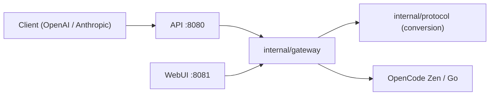

# jasonxu114514/opencode2api

> Go gateway that exposes OpenCode Zen and Zen Go as Chat Completions, Responses and Anthropic Messages APIs.

## The problem
Client tools expect a specific API protocol, whereas OpenCode Zen serves several.

## What it actually does
A single executable with a web interface translates between the three protocols (JSON and SSE), manages pools of Zen and Go keys, proxies, retries, session affinity and model discovery. Admin interface with Playground, token statistics, logs and hot reload. An anonymous mode uses OpenCode's public identifier for the free models.

## How it is wired


## Trying it
```bash
cp config.example.json config.json
go build -o opencode2api ./cmd/opencode2api
./opencode2api -config config.json
```

## Cost and gotchas
Zen or Go keys to provide, except in anonymous mode. The example listens for the web interface on `0.0.0.0:8081`: change the password and go through an HTTPS proxy. Availability probes consume quota.

## What it is not
No embeddings, no files, no image generation. It does not store conversation history. Serves to work around one specific provider.

## Alternatives
CLIProxyAPI: cited as a discovery client, not as an alternative.

## For you
Worth watching if you use OpenCode Zen with several clients; otherwise off topic and GPL.
