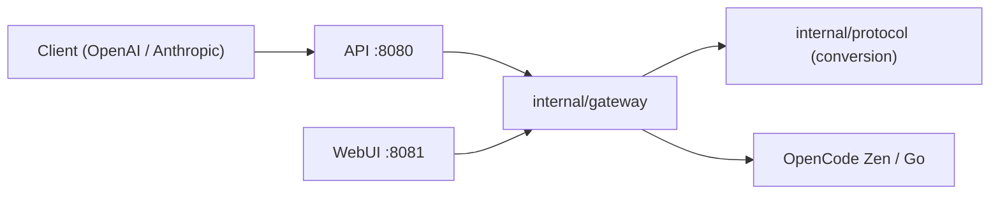

# jasonxu114514/opencode2api

> Passerelle Go qui expose OpenCode Zen et Zen Go en API Chat Completions, Responses et Anthropic Messages.

## Le problème
Les outils clients attendent un protocole d'API précis, alors qu'OpenCode Zen en sert plusieurs.

## Ce que ça fait vraiment
Un seul exécutable avec interface web traduit entre les trois protocoles (JSON et SSE), gère des pools de clés Zen et Go, des proxys, des relances, l'affinité de session et la découverte des modèles. Interface d'administration avec Playground, statistiques de tokens, journaux et rechargement à chaud. Un mode anonyme utilise l'identifiant public d'OpenCode pour les modèles gratuits.

## Comment c'est branché


## Essayer
```bash
cp config.example.json config.json
go build -o opencode2api ./cmd/opencode2api
./opencode2api -config config.json
```

## Coût et pièges
Clés Zen ou Go à fournir, sauf mode anonyme. L'exemple écoute l'interface web sur `0.0.0.0:8081` : changer le mot de passe et passer par un proxy HTTPS. Les sondes de disponibilité consomment du quota.

## Ce que ce n'est pas
Ni embeddings, ni fichiers, ni génération d'images. Il ne stocke pas l'historique de conversation. Sert à contourner un fournisseur précis.

## Alternatives
CLIProxyAPI : cité comme client de découverte, non comme alternative.

## Pour toi
À surveiller si tu utilises OpenCode Zen avec plusieurs clients ; sinon hors sujet et GPL.

