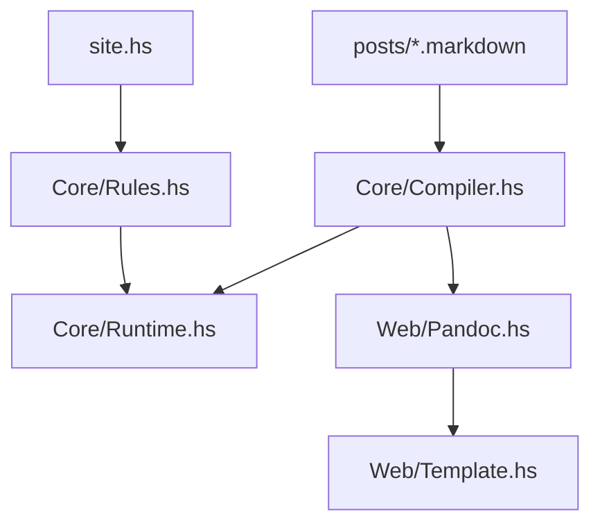

# jaspervdj/hakyll

> Haskell library for generating static sites from rules described in code.

## The problem
A fixed site generator imposes its own structure; you want to describe routes, compilations and templates yourself.

## What it actually does
The site is described in a Haskell file (`site.hs`) with rules, routes and compilers. `Runtime.hs` runs it all: markdown goes through Pandoc and then through templates to produce HTML.

## How it is wired
Diagram based on the code diagram.



## Trying it
```bash
cabal install hakyll
stack install hakyll
```

## Cost and gotchas
Free, but the Haskell toolchain (cabal or stack) is required; the README suggests picking a Stackage snapshot if stack fails. License present but not identified by GitHub.

## What it is not
Not a turnkey tool like Jekyll: you write your own generator in Haskell.

## Alternatives
No alternative named in the README.

## For you
Ignore: only relevant if you write Haskell and want a custom static site.
