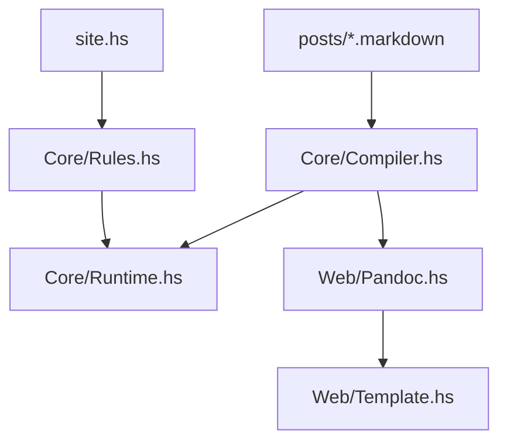

# jaspervdj/hakyll

> Bibliothèque Haskell pour générer des sites statiques à partir de règles décrites en code.

## Le problème
Un générateur de site figé impose sa structure ; on veut décrire soi-même routes, compilations et modèles.

## Ce que ça fait vraiment
Le site se décrit dans un fichier Haskell (`site.hs`) avec règles, routes et compilateurs. `Runtime.hs` exécute le tout : le markdown passe par Pandoc puis par les modèles pour produire du HTML.

## Comment c'est branché
Schéma d'après le diagramme du code.



## Essayer
```bash
cabal install hakyll
stack install hakyll
```

## Coût et pièges
Gratuit, mais la chaîne Haskell (cabal ou stack) est indispensable ; le README suggère de choisir un snapshot Stackage si stack échoue. Licence présente mais non identifiée par GitHub.

## Ce que ce n'est pas
Pas un outil clé en main à la Jekyll : on écrit son générateur en Haskell.

## Alternatives
Aucune alternative nommée dans le README.

## Pour toi
À ignorer : seulement pertinent si tu écris du Haskell et veux un site statique sur mesure.

