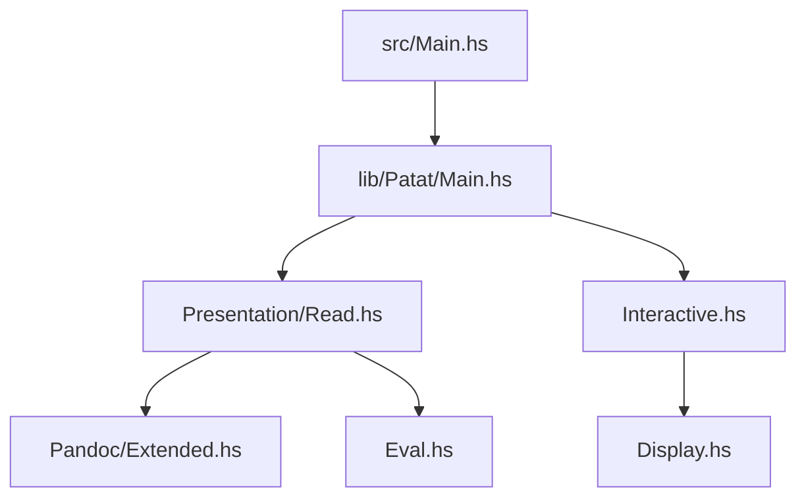

# jaspervdj/patat

> Terminal presentation tool that reads markdown via Pandoc and displays ANSI slides.

## The problem
Giving a technical presentation in your terminal, from a version-controllable text file, without a slide editor.

## What it actually does
Reads any Pandoc format, splits slides, reloads on every save (`--watch`), shows syntax highlighting, themes, transitions, speaker notes in a second file. Can evaluate code blocks and show their output. Images via iTerm2, Kitty, WezTerm or w3m.

## How it is wired
Diagram based on the code diagram.



## Trying it
```bash
cabal install patat
patat --watch slides.md
patat -d slides.md
```

## Cost and gotchas
Free, precompiled binaries or distribution packages. Evaluating code is risky: the README asks you to review downloaded presentations before running them.

## What it is not
Not a graphical presentation tool: no free-form layout, everything goes through the terminal.

## Alternatives
MDP and VTMC, which it is inspired by (cited in the README).

## For you
Watch: handy for presenting results or demos from a repository, especially with code evaluation.
