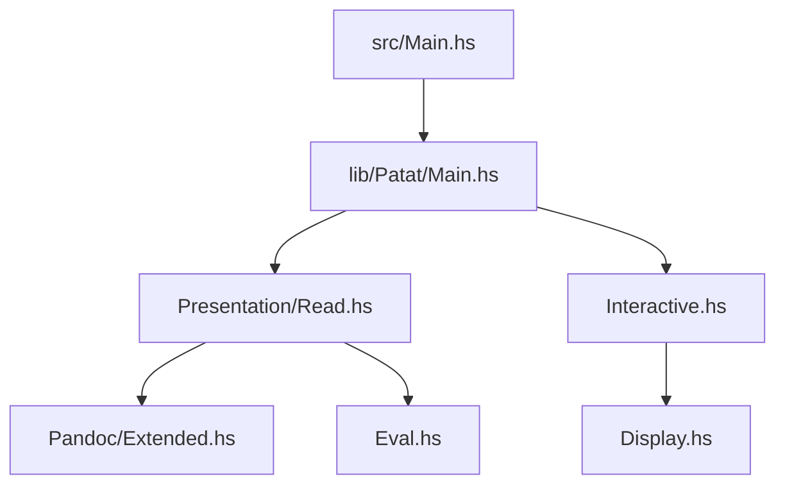

# jaspervdj/patat

> Outil de présentation en terminal qui lit le markdown via Pandoc et affiche des diapositives ANSI.

## Le problème
Faire une présentation technique dans son terminal, depuis un fichier texte versionnable, sans éditeur de diapositives.

## Ce que ça fait vraiment
Lit tout format Pandoc, découpe les diapositives, recharge à chaque sauvegarde (`--watch`), affiche coloration syntaxique, thèmes, transitions, notes d'orateur dans un second fichier. Peut évaluer des blocs de code et en montrer le résultat. Images via iTerm2, Kitty, WezTerm ou w3m.

## Comment c'est branché
Schéma d'après le diagramme du code.



## Essayer
```bash
cabal install patat
patat --watch slides.md
patat -d slides.md
```

## Coût et pièges
Gratuit, binaires précompilés ou paquets de distribution. Évaluer du code est risqué : le README demande de relire les présentations téléchargées avant de les lancer.

## Ce que ce n'est pas
Pas un outil de présentation graphique : pas de mise en page libre, tout passe par le terminal.

## Alternatives
MDP et VTMC, dont il s'inspire (cités dans le README).

## Pour toi
À surveiller : pratique pour présenter des résultats ou démos depuis un dépôt, notamment avec l'évaluation de code.

