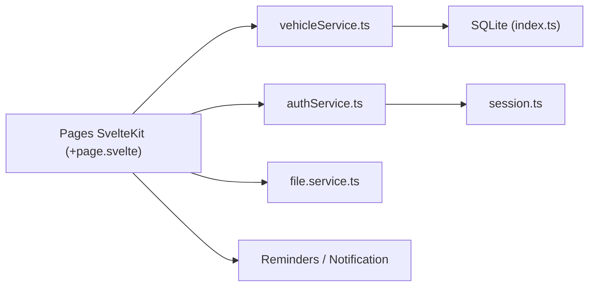

# javedh-dev/tracktor

> Self-hosted fleet tracking application: fuel, maintenance, insurance and reminders per vehicle.

## The problem
Fuel receipts, insurance certificates and maintenance dates get lost between drawers and emails.

## What it actually does
Manages a garage of vehicles with a fuel log, maintenance history, insurance and pollution control (PUCC), reminders before due dates, expenses and reports, and a widget dashboard. Password authentication and optional features that can be enabled. 11 languages advertised (the list names thirteen). SvelteKit frontend (Svelte 5), SQLite via Drizzle, shipped as a Docker image.

## How it is wired


## Trying it
```bash
docker-compose up -d
# puis http://<hôte>:3333
```

## Cost and gotchas
Free. The README warns: active development, frequent breaking changes, "not stable for production", regular backups advised. The README's compose file assumes a `tracktor-data` volume.

## What it is not
Not a stable product nor a data tool. No telematics or sensors: everything is entered by hand.

## Alternatives
No alternative named in the README.

## For you
Ignore: a home application unrelated to data/AI/MLOps, and the README itself advises against production use.
