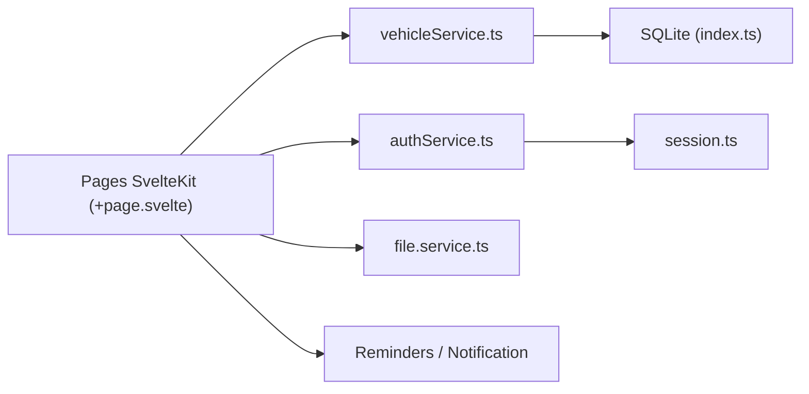

# javedh-dev/tracktor

> Application auto-hébergée de suivi de flotte : carburant, entretien, assurance et rappels par véhicule.

## Le problème
Reçus de carburant, attestations d'assurance et dates d'entretien se perdent entre tiroirs et e-mails.

## Ce que ça fait vraiment
Gère un garage de véhicules avec journal de carburant, historique d'entretien, assurance et contrôle antipollution (PUCC), rappels avant échéance, dépenses et rapports, tableau de bord à widgets. Authentification par mot de passe et options activables. 11 langues annoncées (la liste en cite treize). Frontend SvelteKit (Svelte 5), SQLite via Drizzle, livré en image Docker.

## Comment c'est branché


## Essayer
```bash
docker-compose up -d
# puis http://<hôte>:3333
```

## Coût et pièges
Gratuit. Le README avertit : développement actif, ruptures fréquentes, « non stable pour la production », sauvegardes régulières conseillées. Le fichier compose du README suppose un volume `tracktor-data`.

## Ce que ce n'est pas
Pas un produit stable ni un outil data. Pas de télématique ni de capteurs : tout est saisi à la main.

## Alternatives
Aucune alternative nommée dans le README.

## Pour toi
À ignorer : application domestique sans lien avec data/IA/MLOps, et le README lui-même la déconseille en production.

