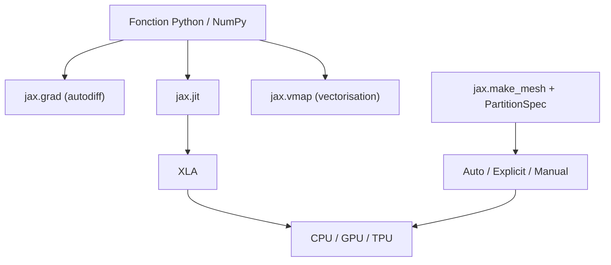

# jax-ml/jax

> Python library for computation on accelerators, through composable function transformations.

## The problem
Differentiating, compiling and vectorizing NumPy numerical code otherwise takes three distinct tools, and
scaling to a thousand accelerators forces a rewrite.

## What it actually does
Automatically differentiates native Python and NumPy functions, through loops, branches,
recursion and closures, and takes derivatives of derivatives to any order.
Supports reverse mode via `jax.grad` and forward mode, arbitrarily composable.
Compiles via XLA to TPU, GPU and other accelerators with `jax.jit`; compilation and differentiation
compose freely. `jax.vmap` maps a function along an axis by pushing the loop down into the primitive operations, turning for example a matrix-vector product into a matrix-matrix one.
For scale, three modes: automatic parallelization by the compiler, explicit sharding
inspectable through `jax.typeof`, and manual per-device programming with explicit collectives.

## How it is wired


## Trying it
```bash
pip install -U jax
pip install -U "jax[cuda13]"
pip install -U "jax[tpu]"
pip install -U "jax[rocm7-local]"
```

## Cost and gotchas
Free. The hardware is not: the benefit shows up on GPU or TPU. `jax.jit` constrains the admissible Python
control flow, which forces some functions to be rewritten. The README itself announces a research project with "sharp edges" and points to a notebook of gotchas.

## What it is not
It is not an official Google product, the README says so. It is not a deep
learning framework: no layers or optimizers, third-party libraries provide them.
It is not a transparent NumPy replacement: arrays are immutable and control flow
is constrained under `jit`.

## Alternatives
No alternative named in the README.

## For you
The right tool if your work is differentiable numerical computing, not assembling layers.
