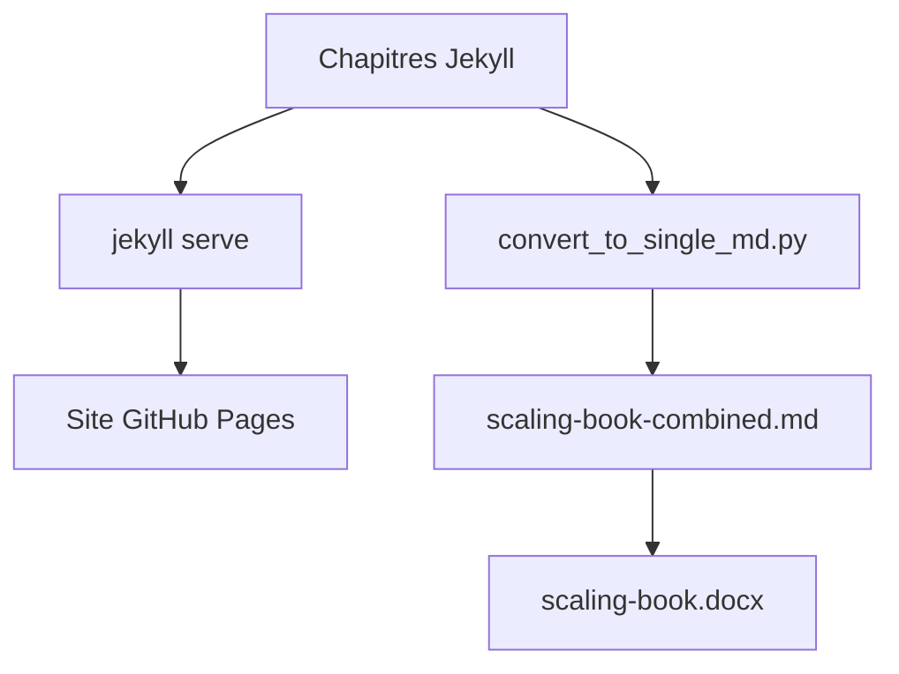

# jax-ml/scaling-book

> Online book from Google DeepMind explaining how to scale LLMs on TPUs.

## The problem
Choosing a parallelism scheme for training or inference without understanding the hardware leads to costly communication bottlenecks.

## What it actually does
This repository hosts the text of the book "How To Scale Your Model", published at jax-ml.github.io/scaling-book. It explains how TPUs work, how LLMs actually run at scale and how to choose parallelisms. A script also produces a single markdown file, convertible to Word with pandoc.

## How it is wired
Simplified diagram based on the sheet, no diagram provided.


## Trying it
```bash
bundle install
bundle exec jekyll serve
python bin/convert_to_single_md.py
pandoc scaling-book-combined.md -o scaling-book.docx
```
Read online: https://jax-ml.github.io/scaling-book.

## Cost and gotchas
Reading online is free. Building it locally requires Ruby 3.4.5 or later, ImageMagick and Jupyter.

## What it is not
Not a code library nor an API tutorial: it is a book. It targets TPUs and JAX.

## Alternatives
No alternative named in the README.

## For you
Adopt: reference reading to understand parallelism and the cost of LLM training and inference, written by a DeepMind team.
