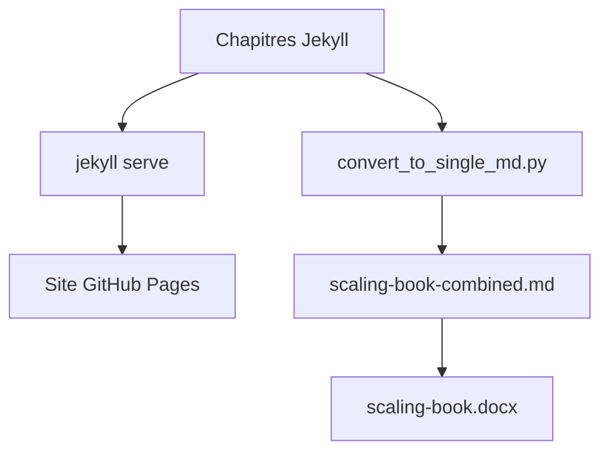

# jax-ml/scaling-book

> Livre en ligne de Google DeepMind expliquant comment mettre à l'échelle les LLM sur TPU.

## Le problème
Choisir un schéma de parallélisme à l'entraînement ou à l'inférence sans comprendre le matériel mène à des goulots de communication coûteux.

## Ce que ça fait vraiment
Ce dépôt héberge le texte du livre « How To Scale Your Model », publié sur jax-ml.github.io/scaling-book. Il explique le fonctionnement des TPU, l'exécution réelle des LLM à grande échelle et le choix des parallélismes. Un script produit aussi un fichier markdown unique, convertible en Word avec pandoc.

## Comment c'est branché
Schéma simplifié d'après la fiche, sans diagramme fourni.


## Essayer
```bash
bundle install
bundle exec jekyll serve
python bin/convert_to_single_md.py
pandoc scaling-book-combined.md -o scaling-book.docx
```
Lecture en ligne : https://jax-ml.github.io/scaling-book.

## Coût et pièges
Lire en ligne est gratuit. Le construire en local demande Ruby 3.4.5 ou plus, ImageMagick et Jupyter.

## Ce que ce n'est pas
Ce n'est pas une bibliothèque de code ni un tutoriel d'API : c'est un livre. Il cible les TPU et JAX.

## Alternatives
Aucune alternative nommée dans le README.

## Pour toi
À adopter : lecture de référence pour comprendre le parallélisme et le coût de l'entraînement et de l'inférence des LLM, écrite par une équipe de DeepMind.

