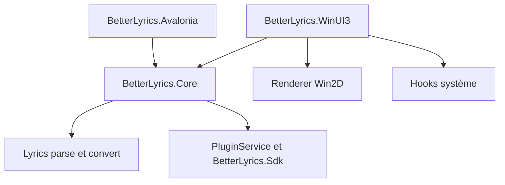

# jayfunc/BetterLyrics

> A lyrics and music player for Windows 11, with animations and source plugins.

## The problem
Synced lyrics display poorly or not at all in common players, with no visual customization.

## What it actually does
A WinUI 3 and Win2D application: syllable-by-syllable highlighted lyrics, animated backgrounds, an audio visualizer, themes adapted to the cover art colors. It fetches lyrics from several providers (LRCLIB, Apple Music, NetEase) and reads local, SMB, WebDAV or FTP libraries. A plugin system adds sources and translations. A second, more limited cross-platform Avalonia client exists.

## How it is wired

## Trying it
No command documented: installation through the Microsoft Store or the zip archive from the releases.

## Cost and gotchas
Windows 11 only. The Store version advertises an unlimited free trial "like the paid version": the commercial model remains unclear. Online donations offered.

## What it is not
Not a data tool: a lyrics player. The Avalonia client is more limited than the Windows version.

## Alternatives
No alternative named in the README.

## For you
Ignore: a music player for Windows, unrelated to data, AI or MLOps work.
