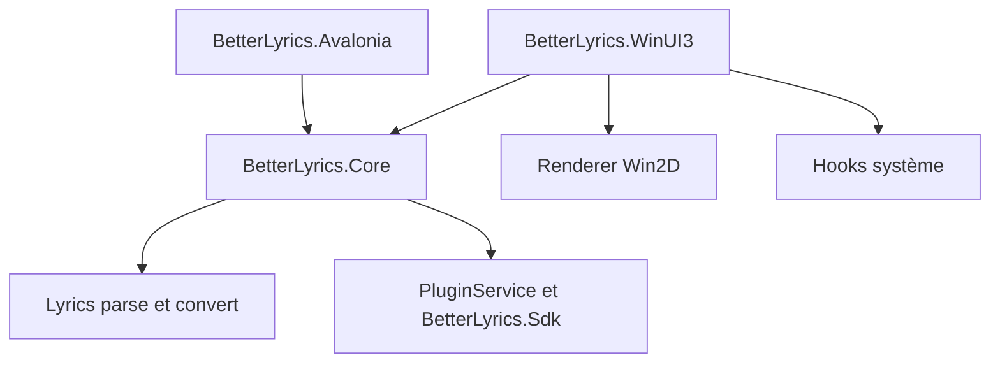

# jayfunc/BetterLyrics

> Un lecteur de paroles et de musique pour Windows 11, avec animations et plugins de sources.

## Le problème
Les paroles synchronisées s'affichent mal ou pas du tout dans les lecteurs courants, sans personnalisation visuelle.

## Ce que ça fait vraiment
Application WinUI 3 et Win2D : paroles à surbrillance par syllabe, fonds animés, visualiseur audio, thèmes adaptés aux couleurs de la pochette. Elle récupère les paroles de plusieurs fournisseurs (LRCLIB, Apple Music, NetEase) et lit des bibliothèques locales, SMB, WebDAV ou FTP. Un système de plugins ajoute des sources et traductions. Un second client Avalonia multiplateforme existe, plus réduit.

## Comment c'est branché

## Essayer
Aucune commande documentée : installation par le Microsoft Store ou par l'archive zip des releases.

## Coût et pièges
Windows 11 uniquement. La version du Store annonce un essai gratuit illimité « comme la version payante » : le modèle commercial reste flou. Dons en ligne proposés.

## Ce que ce n'est pas
Pas un outil pour la data : un lecteur de paroles. Le client Avalonia est plus restreint que la version Windows.

## Alternatives
Aucune alternative nommée dans le README.

## Pour toi
À ignorer : lecteur de musique pour Windows, sans rapport avec le travail data, IA ou MLOps.

