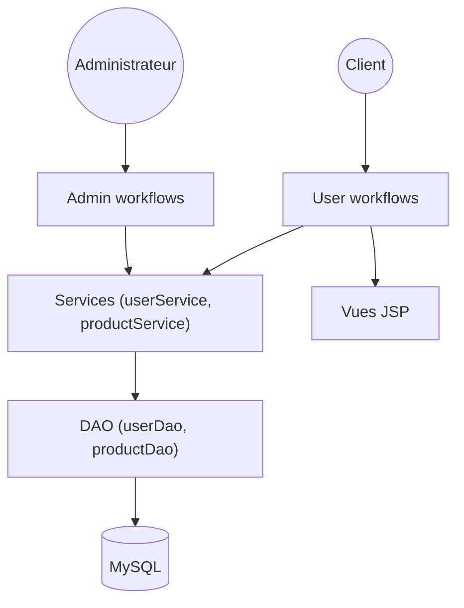

# jaygajera17/E-commerce-project-springBoot

> Java e-commerce web application in JSP and Hibernate, with administrator and customer roles.

## The problem
Learning how to structure a complete online shop with authentication and roles.

## What it actually does
Server-side rendered Spring Boot application: the customer registers, logs in, manages their profile and browses products; the administrator manages products, categories and the customer list. Spring Security separates the ADMIN and USER roles. Hibernate DAOs persist entities in MySQL. Cart code exists but its link with the controllers is not established.

## How it is wired


## Trying it
```bash
git clone https://github.com/jaygajera17/E-commerce-project-springBoot.git
cd E-commerce-project-springBoot
mvn clean package
mvn spring-boot:run
```

## Cost and gotchas
Free; Java 11, Maven and MySQL or MariaDB required. No license declared. The credentials in `basedata.sql` are development values.

## What it is not
Not "production-oriented" despite the README: Spring Boot 2.6 is old, and the cart code is not wired in. It is an educational project.

## Alternatives
No alternative named in the README.

## For you
Ignore: a Java web example unrelated to data or AI, unlicensed, on an aging stack.
