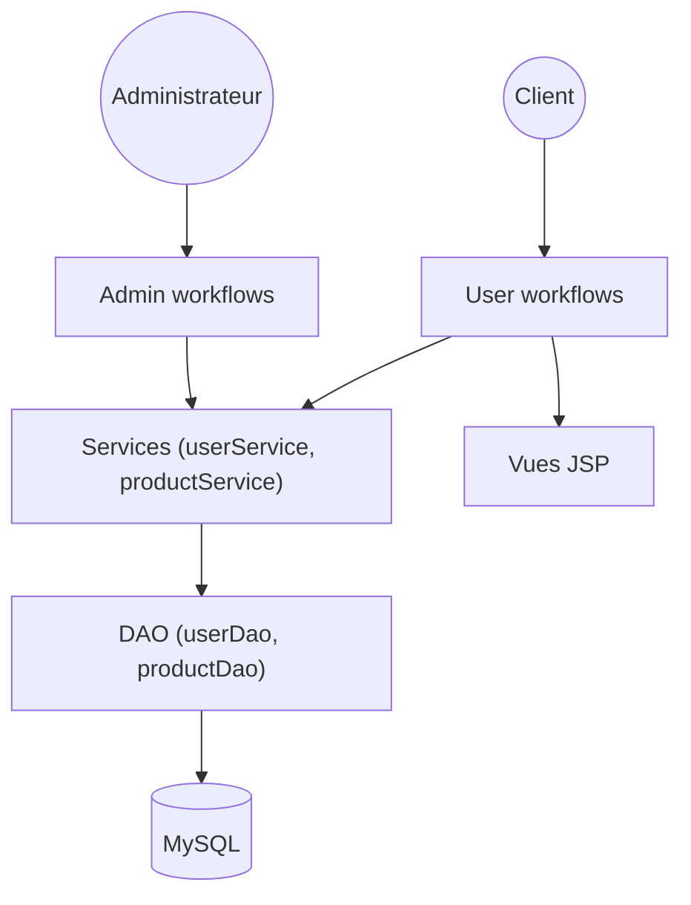

# jaygajera17/E-commerce-project-springBoot

> Application web e-commerce Java en JSP et Hibernate, avec rôles administrateur et client.

## Le problème
Apprendre à structurer une boutique en ligne complète avec authentification et rôles.

## Ce que ça fait vraiment
Application Spring Boot rendue côté serveur : le client s'inscrit, se connecte, gère son profil et parcourt les produits ; l'administrateur gère produits, catégories et liste des clients. Spring Security sépare les rôles ADMIN et USER. Les DAO Hibernate persistent les entités dans MySQL. Un code de panier existe mais son lien avec les contrôleurs n'est pas établi.

## Comment c'est branché


## Essayer
```bash
git clone https://github.com/jaygajera17/E-commerce-project-springBoot.git
cd E-commerce-project-springBoot
mvn clean package
mvn spring-boot:run
```

## Coût et pièges
Gratuit ; Java 11, Maven et MySQL ou MariaDB requis. Aucune licence déclarée. Les identifiants de `basedata.sql` sont des valeurs de développement.

## Ce que ce n'est pas
Pas « orienté production » malgré le README : Spring Boot 2.6 est ancien, et le code de panier n'est pas relié. C'est un projet pédagogique.

## Alternatives
Aucune alternative nommée dans le README.

## Pour toi
À ignorer : exemple de web Java sans rapport avec la data ou l'IA, sans licence, sur une pile vieillissante.

