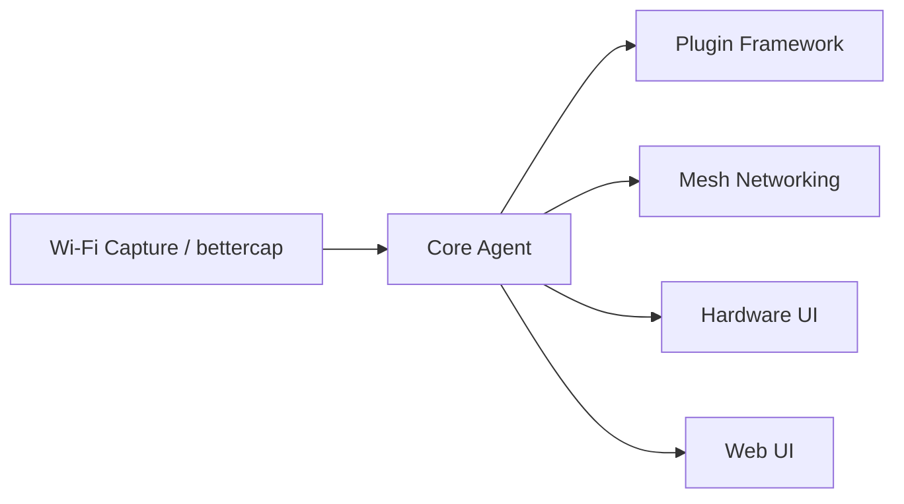

# jayofelony/pwnagotchi

> Raspberry Pi firmware that collects Wi-Fi captures for auditing purposes, with a mascot-style display.

## The problem
Collecting Wi-Fi authentication exchanges to assess the strength of network passwords requires dedicated hardware and a manual installation.

## What it actually does
- A Raspberry Pi drives bettercap to record PCAPNG captures usable with hashcat.
- The AI of older versions was removed for Wi-Fi firmware stability and battery life.
- Several nearby units announce themselves to each other through a custom protocol.
- Plugin system, various display drivers, web interface, translations.

## How it is wired

## Trying it
No command in the README; it points to the wiki (github.com/jayofelony/pwnagotchi/wiki) for installation.

## Cost and gotchas
Hardware to buy (RPi Zero 2W, 3, 4 or 5; the 32-bit Zero W is old, with no new releases). The README does not state the software cost. Lawful use only on networks you are authorized to test.

## What it is not
It is no longer a machine learning project: the AI was removed. It is not a key-cracking tool, it only collects the material to be processed elsewhere. The license is present but not identified by GitHub.

## Alternatives
No alternative named in the README.

## For you
Ignore: Wi-Fi security hardware project, with no active ML since the AI was removed, so of no interest for a data/AI/MLOps profile.
