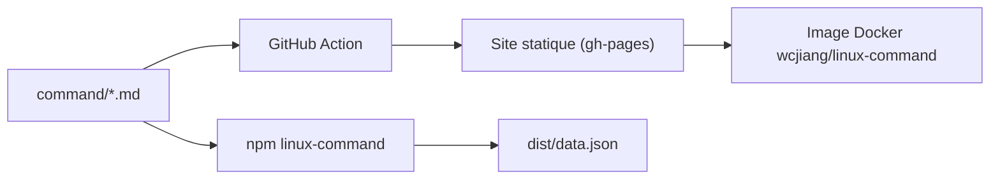

# jaywcjlove/linux-command

> Chinese-language collection of 600+ Linux commands, published as a website, an npm package and a Docker image.

## The problem
Quickly finding the syntax of a Linux command in a readable manual, in Chinese.

## What it actually does
The entries are Markdown files in `command/`. A GitHub Action generates a searchable static site. The `linux-command` npm package exposes the entries and an index (`dist/data.json`), also accessible via unpkg or raw.githubusercontent. The README also lists dozens of mirrors and learning resources.

## How it is wired


## Trying it
```bash
npm install linux-command
docker pull wcjiang/linux-command
docker run --name linux-command --rm -d -p 9665:3000 wcjiang/linux-command:latest
# puis http://localhost:9665/
```

## Cost and gotchas
Free. The author does not guarantee the accuracy of the content and disclaims all liability; the content comes from the web and from contributors.

## What it is not
Not an official manual. Mostly not in English. The mirror lists are third-party self-promotion, not part of the project.

## Alternatives
None cited in the README.

## For you
Ignore: reference written in Chinese, with no guarantee of accuracy; it brings nothing specific to a data/AI profile.
