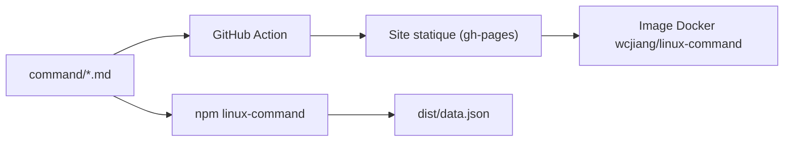

# jaywcjlove/linux-command

> Recueil en chinois de 600+ commandes Linux, publié en site web, paquet npm et image Docker.

## Le problème
Retrouver rapidement la syntaxe d'une commande Linux dans un manuel lisible, en chinois.

## Ce que ça fait vraiment
Les fiches sont des fichiers Markdown dans `command/`. Une action GitHub génère un site statique cherchable. Le paquet npm `linux-command` expose les fiches et un index (`dist/data.json`), accessibles aussi via unpkg ou raw.githubusercontent. Le README liste aussi des dizaines de miroirs et des ressources d'apprentissage.

## Comment c'est branché


## Essayer
```bash
npm install linux-command
docker pull wcjiang/linux-command
docker run --name linux-command --rm -d -p 9665:3000 wcjiang/linux-command:latest
# puis http://localhost:9665/
```

## Coût et pièges
Gratuit. L'auteur ne garantit pas l'exactitude du contenu et décline toute responsabilité ; le contenu provient du web et de contributeurs.

## Ce que ce n'est pas
Pas un manuel officiel. Pas en anglais pour l'essentiel. Les listes de miroirs relèvent de l'auto-promotion de tiers, pas du projet.

## Alternatives
Aucune citée dans le README.

## Pour toi
Ignorer : référence rédigée en chinois, d'exactitude non garantie ; elle n'apporte rien de spécifique à un profil data/IA.

