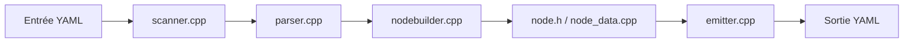

# jbeder/yaml-cpp

> A YAML 1.2 parser and emitter in C++, for C++ developers who read or write configurations.

## The problem
Reading and producing YAML from C++ without writing your own parser.

## What it actually does
The input stream goes through a scanner, then a parser that produces events, then a navigable node graph (`Node`). Conversion to C++ types via `convert.h`, re-emission as YAML by the emitter. An event interface and a `graphbuilder` adapter are provided. Version 0.9.0 announced; the old API will no longer be fixed in 2026.

## How it is wired


## Trying it
```bash
mkdir build
cd build
cmake [-G generator] [-DYAML_BUILD_SHARED_LIBS=on|OFF] ..
```

## Cost and gotchas
Free. Static by default; under MSVC, the static CRT is the default (`YAML_MSVC_SHARED_RT` to change it). The Qt and Unreal wrappers are not official.

## What it is not
Not a Python library: C++ only. Single owner (personal account).

## Alternatives
No alternative named in the README.

## For you
Worth watching: relevant only if you write C++ (embedded inference, tooling); in Python, this is not your tool.
